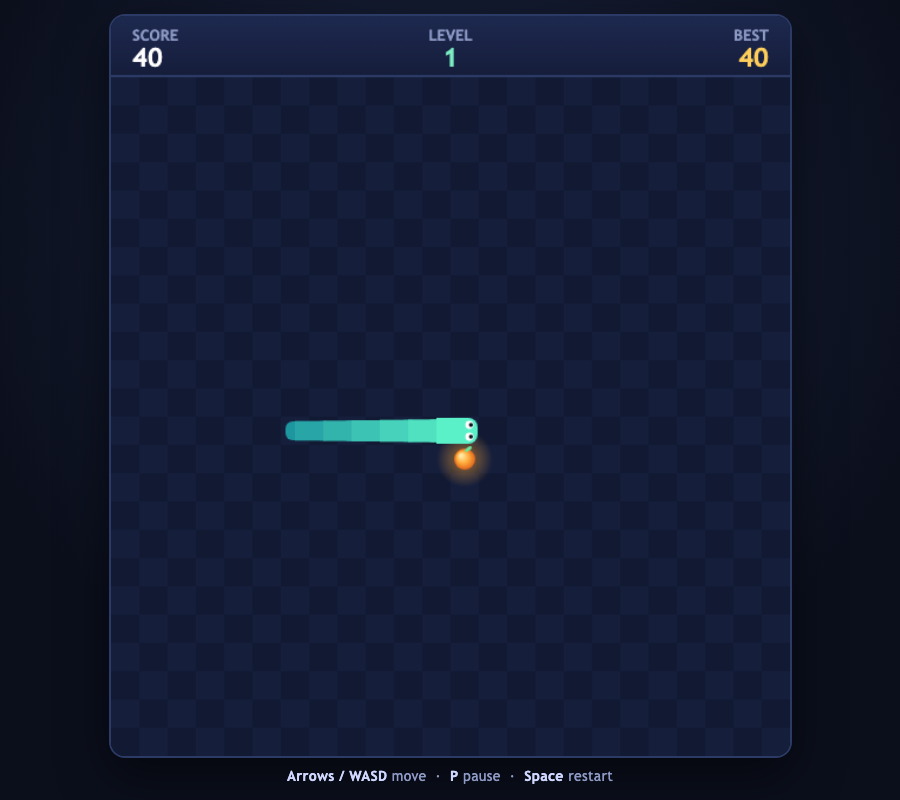

# Example rebuild: Coil (snake game)

An original snake game that runs in the browser from a single `index.html` (plain JavaScript + canvas).



## Play

Open `index.html` in any browser, or run:

```bash
python3 main.py
```

- **Move:** arrow keys or WASD
- **Restart after game over:** Space, Enter or R
- Each fruit is worth 10 points and speeds the snake up. Your best score is saved in the browser.

See [MECHANICS.md](MECHANICS.md) for every number the game uses.

## Checks

`main.py` can also render a screenshot (`--screenshot out.png`) or play a scripted self-test (`--self-test out.json`) in a hidden browser.

Made with no target, from the request alone:

```sh
craft-anything-cli rebuild - "An original snake game that runs in the browser as a single index.html with plain JavaScript and canvas: arrow keys/WASD, score, speed-up, game-over and restart" --rounds 1
```

The build, screenshot and game self-test checks passed. The mechanics check stays unverified: all values in `mechanics.json` are design choices, and no runtime measurement was compared with them.
